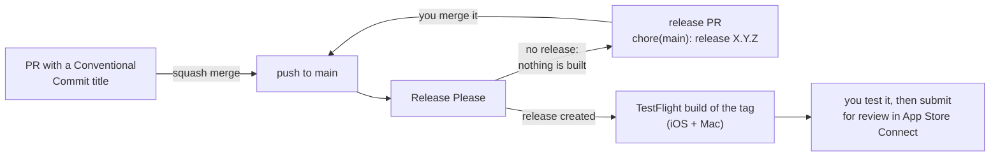

# Release process

This document explains how Middle C goes from a merged pull request to TestFlight
and the App Store: how versions are chosen, what runs on GitHub Actions, what you do
by hand, and how to release from your own Mac.

Before the first release, do the [one-time setup](app-store-setup.md): the App Store
Connect record, the API key, the signing repository and the GitHub secrets.

## At a glance

| When | What happens | What you do |
| --- | --- | --- |
| You open a pull request | The PR title check makes sure the title is a Conventional Commit | Give the PR a title like `feat: Show the next note` |
| A PR is merged into `main` | Release Please opens or updates the release PR with the next version and changelog. Nothing is built or uploaded | Nothing until you want to release |
| You merge the release PR | The version is bumped, tagged `vX.Y.Z`, a GitHub Release is made, and both apps are built from the tag and sent to TestFlight | Test the build in TestFlight, then submit it for review in App Store Connect and release it once Apple approves |



## The pieces

| File | Role |
| --- | --- |
| `.github/workflows/pr-title.yml` | Checks that every PR title is a Conventional Commit |
| `.github/workflows/release-please.yml` | Runs on every push to `main`: updates the release PR, and calls the Release workflow when the release PR is merged |
| `.github/workflows/release.yml` | Builds, signs and uploads with fastlane, once per platform. Can also be run by hand |
| `.github/workflows/ci.yml` | The Build workflow: builds and tests every push and PR. It does not publish anything |
| `release-please-config.json`, `.release-please-manifest.json` | Release Please settings and the last released version |
| `fastlane/Fastfile` | The `certificates`, `build`, `beta` and `release` lanes for `ios` and `mac` |
| `project.yml` | `MARKETING_VERSION`, the version shown in the store |
| `CHANGELOG.md`, `version.txt` | Written by Release Please |

The iPhone/iPad app and the Mac app share one bundle identifier
(`com.liskovlabs.middlec`), so one App Store record covers both (universal
purchase). The Mac App Store build is the sandboxed `PianoTutor-macOS` target in
`project.yml`, not the SwiftPM build that `scripts/build-app.sh` makes.

## Versions and build numbers

Every build has two numbers:

- **Version** (`MARKETING_VERSION`, for example `0.2.0`) is what people see in the
  store. It lives in `project.yml`, on the line marked `# x-release-please-version`,
  and only Release Please changes it. Don't edit it by hand.
- **Build number** (`CURRENT_PROJECT_VERSION`) tells uploads of the same version
  apart. fastlane sets it at build time to one more than the latest build on
  TestFlight for that platform, so iOS and Mac count separately. The `1` in
  `project.yml` is only used for local Xcode builds.

Versions follow [Semantic Versioning](https://semver.org). While the app is below
1.0, `bump-minor-pre-major` is on, so a breaking change raises the minor version
rather than jumping to 1.0.0.

## Pull request titles

[Release Please](https://github.com/googleapis/release-please) works out the next
version from the [Conventional Commit](https://www.conventionalcommits.org)
messages on `main`. Pull requests are squash-merged and the PR title becomes the
commit message, so **the PR title is what counts**. Commits on the branch itself can
be worded any way you like.

| PR title | Next version (while below 1.0) | In the changelog |
| --- | --- | --- |
| `fix: …` | patch: 0.1.0 → 0.1.1 | Bug Fixes |
| `feat: …` | minor: 0.1.0 → 0.2.0 | Features |
| `feat!: …`, or a `BREAKING CHANGE:` footer | minor while below 1.0, major after | Features, marked as breaking |
| `perf: …` | patch | Performance Improvements |
| `revert: …` | patch | Reverts |
| `docs:`, `chore:`, `ci:`, `refactor:`, `test:`, `build:` | none | left out |

A scope is optional: `fix(midi): Reconnect after sleep`. The PR title check
(`pr-title.yml`) fails until the title starts with one of `feat`, `fix`, `perf`,
`revert`, `refactor`, `docs`, `test`, `build`, `ci` or `chore`. If you edit the
title, the check runs again.

The title is also the changelog line, so write it for someone reading the release
notes: `feat: Play songs at 60% speed`, not `feat: add speed param`.

## Every push to `main`

`release-please.yml` runs on every push to `main`, but an ordinary push only updates
the release PR (see below). Nothing is built or uploaded until the release PR is
merged. The Build workflow (`ci.yml`) still builds and tests every push, without
signing or uploading.

To get a TestFlight build between releases, run the Release workflow by hand with
the `beta` lane (see [Running the Release workflow by hand](#running-the-release-workflow-by-hand)).
It carries the last released `MARKETING_VERSION` with a higher build number.

## What an upload does

The Release workflow, for iOS and Mac in parallel:

1. Checks out the tag (or, for a manual run, the branch you chose) and installs Ruby
   gems and XcodeGen on a `macos-26` runner.
2. Writes the App Store Connect key from the `ASC_KEY_P8` secret to a file.
3. Runs `bundle exec fastlane <ios|mac> <release|beta>`, which:
   1. runs `xcodegen generate`;
   2. fetches the distribution certificate and App Store profile from the signing
      repository with match (read-only on CI);
   3. switches the app target from automatic signing to that certificate and profile;
   4. asks App Store Connect for the latest TestFlight build number and adds one;
   5. archives and exports a signed `.ipa` or `.pkg` into `build/fastlane`;
   6. uploads it: `beta` to TestFlight without waiting for Apple to process it,
      `release` with `deliver` (see [Running the Release workflow by hand](#running-the-release-workflow-by-hand)).
4. Keeps the `.ipa`/`.pkg` and the dSYMs as a workflow artifact
   (`MiddleC-ios-<run>` or `MiddleC-mac-<run>`) for 30 days.
5. Deletes the key file.

Apple takes a few minutes to process an upload before it appears in TestFlight.
Internal testers get it straight away; external testers need the build added to
their group, and the first build of each version goes through Beta App Review.

Uploads for the same platform and lane queue rather than run side by side, so two
runs never pick the same build number.

## The release PR

On the same push, Release Please looks at the Conventional Commits since the last
release. If any of them would change the version, it opens a pull request titled
something like `chore(main): release 0.2.0`, or updates the one already open. The
PR:

- sets `MARKETING_VERSION` in `project.yml` to the new version;
- updates `version.txt` and `.release-please-manifest.json`;
- adds the new section to `CHANGELOG.md`.

It keeps itself up to date as more PRs land, so leave it open until you are ready to
release. Don't push your own commits to it; Release Please rewrites it on the next
push to `main`.

Release Please opens the PR with the workflow's `GITHUB_TOKEN`. GitHub doesn't
start other workflows for events made with that token, so neither the Build
workflow nor the PR title check runs on the release PR. That's fine, because it only
changes the version and the changelog.

## Making a release

1. **Read the release PR.** Check that the version is the one you expect and that
   the changelog reads well. The lines come from commits already on `main`, so
   they can't be reworded at the source. To fix one, merge the release PR as it is,
   then edit the GitHub Release notes and correct `CHANGELOG.md` in a `docs:` PR.
2. **Merge the release PR** (squash, like any other PR).
3. **Release Please, on that push to `main`:**
   - tags the merge commit `vX.Y.Z`;
   - creates a GitHub Release with the changelog section as its notes;
   - calls the Release workflow with the `beta` lane and the tag.
4. **The Release workflow** checks out the tag, stops with an error if the tag
   doesn't match `MARKETING_VERSION` in `project.yml`, and runs
   `bundle exec fastlane <ios|mac> beta` for both platforms (see
   [What an upload does](#what-an-upload-does)).
5. **Test it in TestFlight.** The build appears in TestFlight once Apple has
   processed it, a few minutes later. Try it on a device and on a Mac. If something
   is wrong, merge a `fix:` PR and release again; the broken version is never
   submitted.
6. **Submit for review.** In App Store Connect, add the new version for iOS and for
   macOS (**+** next to the platform) if it isn't there yet. For each one: select
   the TestFlight build, fill in **What's New in This Version** (the GitHub Release
   notes are a good start), check the screenshots, and click **Add for Review**,
   then **Submit for Review**.

   Or run the Release workflow by hand from the tag with lane `release` and
   **Submit for review** ticked (see below). That builds and uploads again with a
   new build number, creates the version and submits it, but still won't fill in
   What's New for you.
7. **Release it.** When Apple approves a version it waits as **Pending Developer
   Release**. Click **Release This Version** in App Store Connect.

### Choosing the version yourself

To release a specific version, for example the first 1.0.0, add a `Release-As`
footer to the body of a squash-merged PR (it goes into the commit message on
`main`):

```
feat: Finish the course

Release-As: 1.0.0
```

Release Please then proposes that version in the release PR. After 1.0.0, a
`feat!:` or `BREAKING CHANGE:` raises the major version.

### Releasing a fix quickly

There is no separate hotfix branch. Merge the `fix:` PR into `main`, then merge the
release PR, which now proposes the next patch version. Any unreleased features already on `main` ship with it.

## Running the Release workflow by hand

Actions → **Release** → **Run workflow**, then choose:

| Input | Values | Meaning |
| --- | --- | --- |
| Use workflow from | a branch such as `main`, or a tag such as `v0.2.0` | The code that is built |
| Which app | `both`, `ios`, `mac` | One platform or both |
| `lane` | `beta`, `release` | TestFlight, or the App Store |
| Submit for review | on / off | Only for `release`: submit the uploaded build for review |

A manual run builds the branch or tag you choose, with its `MARKETING_VERSION`.
From a tag, it first checks that the tag matches that version. Use it to:

- send a TestFlight build of `main` (or a branch) between releases;
- retry an upload that failed;
- build one platform only;
- submit a release from its tag in one step (lane `release`, **Submit for review** on).

## Releasing from your Mac

The same lanes work locally once `fastlane/.env` is filled in (see the
[one-time setup](app-store-setup.md)):

| Command | What it does |
| --- | --- |
| `bundle exec fastlane ios beta` / `mac beta` | Build, sign and upload to TestFlight |
| `bundle exec fastlane ios release` / `mac release` | Upload to the App Store; add `submit:true` to submit for review |
| `bundle exec fastlane ios build` / `mac build` | Signed `.ipa` / `.pkg` in `build/fastlane`, no upload |
| `bundle exec fastlane ios certificates` / `mac certificates` | Create or fetch the signing certificate and profile |

A local release uses whatever `MARKETING_VERSION` your checkout has, so release
from an up-to-date `main` (or the tag) and let Release Please own the version
number. Certificates can only be created or renewed locally; on CI, match only
reads the signing repository.

## Secrets and settings

The Release workflow reads these repository secrets (Settings → Secrets and
variables → Actions). The [one-time setup](app-store-setup.md#step-5-github-actions-secrets-only-for-ci-releases)
has the commands to set them.

| Secret | Value |
| --- | --- |
| `ASC_KEY_ID`, `ASC_ISSUER_ID` | From the App Store Connect API page |
| `ASC_KEY_P8` | The contents of the `.p8` key file |
| `MATCH_GIT_URL` | HTTPS URL of the signing repository |
| `MATCH_PASSWORD` | The match passphrase |
| `MATCH_GIT_BASIC_AUTHORIZATION` | `echo -n "github-user:token" \| base64`, with a token that can read the signing repository |
| `TEAM_ID` | Your Apple developer team ID |

The bundle identifier defaults to `com.liskovlabs.middlec`. To release under a
different one, add a repository **variable** (not a secret, so it stays readable in
the logs) named `APP_BUNDLE_ID`.

Release Please also needs Settings → Actions → General → **Allow GitHub Actions to
create and approve pull requests** ticked, or it can't open the release PR.

## Troubleshooting

**The PR title check fails.** The title doesn't start with an allowed type and a
colon. Edit the title; the check runs again. A capital letter after the colon is
fine.

**No release PR appears.** Only `feat`, `fix`, `perf`, `revert` and breaking changes
make a release; a run of `docs:`, `ci:` and `chore:` PRs doesn't, and the Release
Please job log then ends with "No user facing commits found … skipping". To release
anyway, merge a PR with a `Release-As: X.Y.Z` footer (see
[Choosing the version yourself](#choosing-the-version-yourself)). If there are
releasable commits, check that Actions may create pull requests (above).

**The release PR shows the wrong version.** Merge a PR with a `Release-As: X.Y.Z`
footer in its commit body, or correct the type of the PR titles that come after.
Titles already merged can't be changed.

**"Tag vX.Y.Z does not match MARKETING_VERSION".** The tagged commit has a different
version in `project.yml`. Usually the `# x-release-please-version` marker was
removed or the line was edited by hand. Restore the marker and let the next release
PR set the version.

**TestFlight rejects a manual beta because the version is closed** (for example
"The train version '0.2.0' is closed for new build submissions"). Once a version is
approved, App Store Connect takes no new builds for it, and a beta run by hand
between releases still carries it. Merge the next release PR instead, which brings
a new version.

**match fails on CI** ("Could not clone", authentication errors). Check that
`MATCH_GIT_URL` is the HTTPS URL, and that the token in
`MATCH_GIT_BASIC_AUTHORIZATION` hasn't expired and can read the signing repository.

**A certificate or profile has expired.** Run `bundle exec fastlane ios certificates`
and `mac certificates` on your Mac with an Admin API key. CI picks up the new files
from the signing repository on its next run.

**An upload fails half way.** Each platform runs as its own job, so the other one
may have succeeded. Re-run the failed job, or run the Release workflow by hand for
that platform only. The build number is worked out again, so a retry never clashes.
